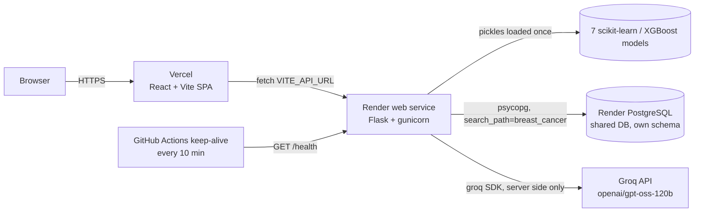

# Breast Cancer Predictor

Seven trained machine-learning models classify breast-mass cell-nucleus measurements as benign or malignant, side by side, with a plain-language AI explanation of the result.

> **Medical disclaimer.** This is an educational project. It is not a medical device and cannot diagnose cancer. Anyone with symptoms or concerns should see a doctor.

**Live demo:** frontend `https://<your-app>.vercel.app` · API `https://<your-api>.onrender.com/health`

## Features

- **Validated prediction API.** All 7 models load once at startup. A pydantic schema checks the 30 features (names, count, finite, 0 to 10 000). You can pick the model, and the API returns the probability of malignancy plus the verdict of every other model for the same input.
- **Real hold-out metrics.** `/api/models` reports accuracy, precision, recall, F1, ROC AUC and the confusion matrix for each model. The numbers come from the notebook's exact 114-case test split (rebuilt by `scripts/evaluate_models.py`) and match the notebook, for example 98.25% for the tuned Random Forest.
- **Out-of-range warnings.** The API flags any value outside the range seen in training.
- **AI explanation (Groq).** `/api/explain` re-runs the prediction on the server, then asks `openai/gpt-oss-120b` to explain it in plain words, comparing the six most important measurements with typical benign and malignant values. It is rate limited, and errors come back as clear JSON messages.
- **Prediction log in Postgres.** Every prediction is stored anonymously and shown in the UI (totals, malignant share, recent rows). A seed adds 60 demo rows built from real dataset samples.
- **Frontend.** Built with React, TypeScript and Tailwind. It has real benign and malignant sample presets, inline validation, a result card with model agreement, a model comparison chart, skeleton and error states, toasts, a "waking up the server" banner for cold starts, and a responsive layout down to 375 px.
- **Production setup.** CORS allow-list, security headers, rate limits, consistent JSON errors, gunicorn, pinned dependencies, CI, a Render Blueprint and a keep-alive workflow.

## Screenshots

| Desktop | Mobile (375 px) |
| --- | --- |
|  |  |

## Architecture



## Tech stack

| Layer | Tools |
| --- | --- |
| ML | scikit-learn 1.6.1 (Random Forest x2, Decision Tree, Logistic Regression, SVC, KNN), XGBoost, pandas, NumPy |
| API | Flask 3, pydantic 2, Flask-Limiter, flask-cors, gunicorn, psycopg 3, Groq SDK |
| Data | PostgreSQL (own schema), SQL migrations + idempotent seed |
| Frontend | React 19, TypeScript, Vite, Tailwind CSS 4, sonner |
| Quality | pytest, ruff, Vitest + Testing Library, ESLint, Prettier, GitHub Actions |

## API

| Method | Path | Description |
| --- | --- | --- |
| GET | `/health` | Runs `SELECT 1`. Returns `{"status":"ok","db":"ok"}`, or 503 with `db:"error"` |
| GET | `/api/models` | Models with hold-out metrics |
| GET | `/api/features` | Feature names and training ranges and medians |
| POST | `/api/predict` | `{"model"?, "features": [30 numbers] or {name: value}, "compare"?}` |
| POST | `/api/explain` | Same body. Returns a plain-language explanation (10 per minute, 100 per day per IP) |
| GET | `/api/predictions/stats` | Totals and recent predictions from the log |
| POST | `/predict` | Original v1 contract `{"features":[...]}` returning `{"prediction":0 or 1}`, kept for old clients |

```bash
curl -X POST localhost:5108/api/predict -H 'content-type: application/json' \
  -d '{"model":"xgboost","features":[17.99,10.38,122.8,1001,0.1184,0.2776,0.3001,0.1471,0.2419,0.07871,1.095,0.9053,8.589,153.4,0.006399,0.04904,0.05373,0.01587,0.03003,0.006193,25.38,17.33,184.6,2019,0.1622,0.6656,0.7119,0.2654,0.4601,0.1189]}'
```

Errors always have the shape `{"error": {"code", "message", "details"?}}`.

## Local setup

Prerequisites: Python 3.13, Node 20.19 or newer, and a Postgres instance (for example `docker run -p 5433:5432 -e POSTGRES_PASSWORD=postgres -e POSTGRES_DB=portfolio postgres:16`).

```bash
# backend (port 5108)
python -m venv .venv && source .venv/bin/activate   # Windows: .venv\Scripts\activate
pip install -r requirements-dev.txt
cp .env.example .env                                # then fill in GROQ_API_KEY
set -a && . ./.env && set +a                        # or export the variables another way
python -m predictor.migrate                         # creates the schema and tables, seeds demo rows
python app.py                                       # http://localhost:5108

# frontend (port 5204)
cd frontend
cp .env.example .env
npm install
npm run dev                                         # http://localhost:5204

# checks
ruff check . && ruff format --check . && pytest
cd frontend && npm run lint && npm test && npm run build
```

To rebuild `models/metrics.json` after retraining, run `python scripts/evaluate_models.py`.

## Environment variables

| Variable | Where | Required | Description |
| --- | --- | --- | --- |
| `DATABASE_URL` | API | yes | Postgres connection string |
| `DB_SCHEMA` | API | no (`breast_cancer`) | Schema that holds this app's tables (lowercase identifier) |
| `FRONTEND_URL` | API | yes in prod | Allowed CORS origins, comma-separated |
| `GROQ_API_KEY` | API | for `/api/explain` | Groq key. Without it the endpoint returns 503 `ai_unavailable` |
| `GROQ_MODEL` | API | no | Defaults to `openai/gpt-oss-120b` |
| `FLASK_ENV` | API | no | `production` turns on HSTS |
| `RATE_LIMIT_STORAGE_URI` | API | no | Flask-Limiter storage. Default `memory://` (one worker) |
| `PORT` | API | set by Render | Bind port |
| `VITE_API_URL` | Frontend | yes | API base URL, no trailing slash |

## Deploy

1. **Database.** Create the shared Render PostgreSQL instance once, by hand. This app creates and uses its own `breast_cancer` schema.
2. **API (Render Blueprint).** In Render, go to New, then Blueprint, and pick this repo. `render.yaml` declares the web service. Set `DATABASE_URL` (the shared DB's internal URL), `GROQ_API_KEY`, and `FRONTEND_URL` (your Vercel URL). Migrations and the seed run on every boot and are idempotent.
3. **Frontend (Vercel).** Import the repo, set the root directory to `frontend`, and set the environment variable `VITE_API_URL=https://<your-api>.onrender.com`. `vercel.json` handles SPA rewrites.
4. **Keep-alive.** In GitHub, open Settings, then Secrets and variables, then Actions, then Variables, and add `BACKEND_URL=https://<your-api>.onrender.com`. `.github/workflows/keep-alive.yml` pings `/health` every 10 minutes.

## Project structure

```
app.py                      WSGI entry (gunicorn app:app)
predictor/
  app.py                    Flask app factory, routes, errors, CORS, headers, limits
  catalog.py                feature order, model registry ids
  ml.py                     loads the pickles once, predicts
  schemas.py                pydantic request validation
  db.py                     Postgres access + migration runner
  migrate.py                python -m predictor.migrate (migrations + seed)
  explain.py                Groq explanation with error mapping
migrations/                 SQL migrations (applied once, tracked in schema_migrations)
models/                     trained pickles + metrics.json
notebooks/                  original training notebook
scripts/evaluate_models.py  rebuilds metrics.json from the notebook's split
tests/                      pytest API + model tests
frontend/                   Vite + React + TS + Tailwind client
render.yaml                 Render Blueprint
.github/workflows/          CI and keep-alive
```

## Model notes

The models were trained in `notebooks/cancer_prediction.ipynb` with `GridSearchCV` on the 569-sample WDBC dataset, holding out 20% for testing. The tuned Random Forest (450 trees) is the default model because it scored best on that test split (98.25% accuracy, 100% malignant recall). The test set has only 114 cases, so treat these numbers as rough. The pickles need scikit-learn 1.6.1, so keep that version pinned.

## Credits

Dataset: W. H. Wolberg, W. N. Street and O. L. Mangasarian, *Breast Cancer Wisconsin (Diagnostic)*, UCI Machine Learning Repository. The original models and notebook are from the upstream project by Aaditya Mittal.
