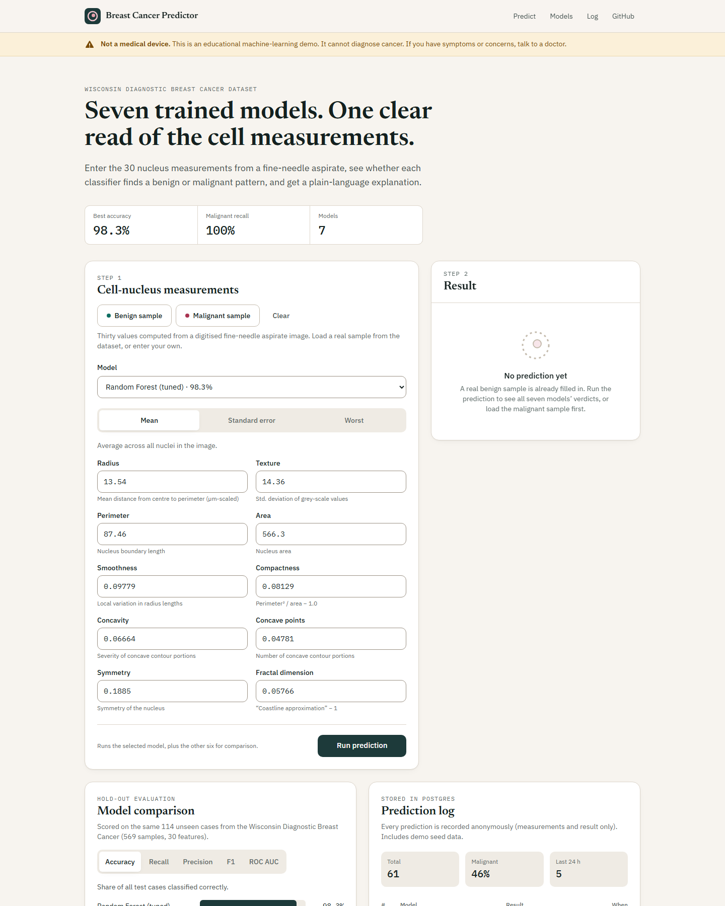
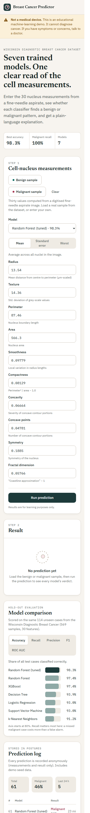
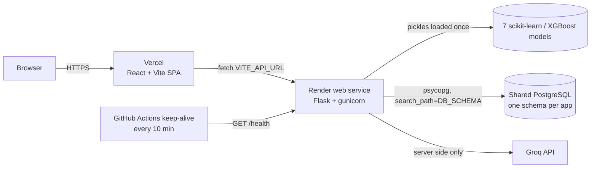

# Breast Cancer Predictor

**Seven trained ML models read 30 cell-nucleus measurements side by side, then an LLM explains the verdict in plain words.**

[](https://github.com/HarshBathija-04/Breast-Cancer-Predictor-Backend/actions/workflows/ci.yml)


**Live demo:** [frontend](https://your-app.vercel.app) · [API health](https://your-api.onrender.com/health) _(replace with your deployed URLs)_

> **Medical disclaimer.** Educational project only. It is not a medical device and cannot diagnose cancer. Anyone with symptoms or concerns should see a doctor.

## Features

- **Seven models, one request.** Tuned Random Forest, Random Forest, XGBoost, Decision Tree, Logistic Regression, SVM and KNN all answer for the same input, with a model-agreement view.
- **Real hold-out metrics.** Accuracy, precision, recall, F1, ROC AUC and confusion matrix per model, rebuilt from the notebook's exact 114-case test split (98.25% for the tuned Random Forest).
- **Plain-language AI explanation.** Groq (`openai/gpt-oss-120b`) compares the six most important measurements with typical benign and malignant values.
- **Strict input validation.** 30 named or ordered numbers, finite, 0 to 10 000, plus a warning when a value falls outside the training range.
- **Anonymous prediction log in Postgres** with totals, malignant share and recent rows, seeded with 60 demo rows from real samples.
- **Built for a free-tier deploy.** "Waking up the server" banner and retries for cold starts, plus a keep-alive workflow.

## Screenshots

| Desktop | Mobile (375 px) |
| --- | --- |
|  |  |

## Architecture



## Tech stack

| Layer | Tools |
| --- | --- |
| ML | scikit-learn 1.6.1, XGBoost, pandas, NumPy |
| API | Flask 3, pydantic 2, Flask-Limiter, flask-cors, gunicorn, psycopg 3, Groq SDK |
| Data | PostgreSQL (own schema), plain SQL migrations, idempotent seed |
| Frontend | React 19, TypeScript, Vite, Tailwind CSS 4, sonner |
| Quality | pytest, ruff, Vitest + Testing Library, ESLint, Prettier, GitHub Actions |

## Quick start

Needs Python 3.13, Node 20.19+ and a Postgres instance, for example:
`docker run -d -p 5433:5432 -e POSTGRES_PASSWORD=postgres -e POSTGRES_DB=portfolio postgres:16`

```bash
# API on http://localhost:5108 (bash or Git Bash)
python -m venv .venv && source .venv/bin/activate   # Windows: source .venv/Scripts/activate
pip install -r requirements-dev.txt
cp .env.example .env                                # add GROQ_API_KEY to enable explanations
set -a && . ./.env && set +a
python -m predictor.migrate                         # creates the schema and tables, seeds demo rows
python app.py

# Frontend on http://localhost:5204 (second terminal)
cd frontend && cp .env.example .env && npm install && npm run dev
```

Checks, the same ones CI runs:

```bash
ruff check . && ruff format --check . && pytest
cd frontend && npm run lint && npm test && npm run build
```

`pytest` uses its own `breast_cancer_test` schema and skips the database tests when Postgres is not reachable.

## Environment variables

| Variable | Where | Required | Description |
| --- | --- | --- | --- |
| `DATABASE_URL` | API | yes | Postgres connection string |
| `DB_SCHEMA` | API | no (`breast_cancer`) | Schema holding this app's tables (lowercase identifier) |
| `FRONTEND_URL` | API | yes in prod | Allowed CORS origins, comma-separated (default `http://localhost:5204`) |
| `GROQ_API_KEY` | API | for `/api/explain` | Without it the endpoint returns 503 `ai_unavailable` |
| `GROQ_MODEL` | API | no | Default `openai/gpt-oss-120b` |
| `FLASK_ENV` | API | no | `production` turns on HSTS |
| `RATE_LIMIT_STORAGE_URI` | API | no | Flask-Limiter storage, default `memory://` (fine for one worker) |
| `PORT` | API | set by Render | Bind port (local default 5108) |
| `VITE_API_URL` | Frontend | yes | API base URL, no trailing slash |

## Deploy

1. **Database.** Use the shared Render PostgreSQL instance (created once, by hand). This app only touches its own `DB_SCHEMA` schema.
2. **API (Render Blueprint).** New, then Blueprint, then pick this repo. `render.yaml` sets `DB_SCHEMA=breast_cancer` and `FLASK_ENV=production`. Fill in `DATABASE_URL` (the shared DB's internal URL), `GROQ_API_KEY` and `FRONTEND_URL` (your Vercel URL). Migrations and the seed run on every boot and are idempotent.
3. **Frontend (Vercel).** Import the repo, set the root directory to `frontend` and add `VITE_API_URL=https://<your-api>.onrender.com`. `vercel.json` handles SPA rewrites and security headers.
4. **Keep-alive.** In GitHub, Settings, then Secrets and variables, then Actions, then Variables: add `BACKEND_URL=https://<your-api>.onrender.com`. `.github/workflows/keep-alive.yml` pings `/health` every 10 minutes and skips quietly while the variable is unset.

## API

| Method | Path | Description |
| --- | --- | --- |
| GET | `/health` | Runs `SELECT 1`. `{"status":"ok","db":"ok"}`, or 503 with `"db":"error"` |
| GET | `/api/models` | Models with hold-out metrics |
| GET | `/api/features` | Feature names, training ranges and medians |
| POST | `/api/predict` | `{"model"?, "features": [30 numbers] or {name: value}, "compare"?}` |
| POST | `/api/explain` | Same body. Plain-language explanation (10 per minute, 100 per day per IP) |
| GET | `/api/predictions/stats` | Totals and recent predictions from the log |
| POST | `/predict` | Original v1 contract: `{"features":[...]}` returns `{"prediction":0 or 1}` |

```bash
curl -X POST localhost:5108/api/predict -H 'content-type: application/json' \
  -d '{"model":"xgboost","features":[17.99,10.38,122.8,1001,0.1184,0.2776,0.3001,0.1471,0.2419,0.07871,1.095,0.9053,8.589,153.4,0.006399,0.04904,0.05373,0.01587,0.03003,0.006193,25.38,17.33,184.6,2019,0.1622,0.6656,0.7119,0.2654,0.4601,0.1189]}'
```

Every error has the shape `{"error": {"code", "message", "details"?}}`.

## Engineering highlights

- **Schema-per-app on a shared database.** One free Postgres serves several portfolio apps; each connection sets `search_path` to `DB_SCHEMA`, and the name is checked against a strict identifier regex because schema names cannot be bound as SQL parameters.
- **Transactional, tracked migrations.** Each `migrations/*.sql` file runs once inside a transaction and is recorded in `schema_migrations`; CI runs migrate twice to prove it is idempotent.
- **Logging never blocks a prediction.** If the database is down, `/api/predict` still answers with `logged: false`; `/health` reports the outage as 503 for the keep-alive and Render.
- **The LLM cannot be fed a fake verdict.** `/api/explain` recomputes the prediction server side and only sends the model's own output and real feature medians to Groq, with Groq errors mapped to clear 429/502/503/504 responses.
- **Models load once.** All seven pickles load at startup and are shared by every request; the scikit-learn version is pinned to the one they were trained with.
- **Hardened by default.** CORS allow-list, CSP and other security headers, per-route rate limits, a 16 KB body limit, and pydantic models that forbid unknown fields.
- **Cold starts handled in the UI.** Requests slower than 4 s show a "waking up the server" banner, and idempotent GETs retry on 502/503 while Render boots.

## Project structure

```
app.py                      WSGI entry (gunicorn app:app)
predictor/
  app.py                    Flask app factory: routes, errors, CORS, headers, limits
  catalog.py                feature order and model ids
  ml.py                     loads the pickles once, predicts
  schemas.py                pydantic request validation
  db.py                     Postgres access and migration runner
  migrate.py                python -m predictor.migrate (migrations + seed)
  explain.py                Groq explanation with error mapping
migrations/                 SQL migrations
models/                     trained pickles + metrics.json
notebooks/                  original training notebook
scripts/evaluate_models.py  rebuilds metrics.json from the notebook's split
tests/                      pytest API and model tests
frontend/src/
  App.tsx                   page layout and data flow
  components/               form, result, model comparison, prediction log
  lib/                      API client and feature metadata
render.yaml                 Render Blueprint
.github/workflows/          CI and keep-alive
```

## Model notes

Trained in `notebooks/cancer_prediction.ipynb` with `GridSearchCV` on the 569-sample WDBC dataset, holding out 20% for testing. The tuned Random Forest (450 trees) is the default because it scored best on that split (98.25% accuracy, 100% malignant recall). The test set has only 114 cases, so treat these numbers as rough. After retraining, run `python scripts/evaluate_models.py` to rebuild `models/metrics.json`.

## Credits

Dataset: W. H. Wolberg, W. N. Street and O. L. Mangasarian, *Breast Cancer Wisconsin (Diagnostic)*, UCI Machine Learning Repository. The original models and notebook come from the upstream project by Aaditya Mittal.
